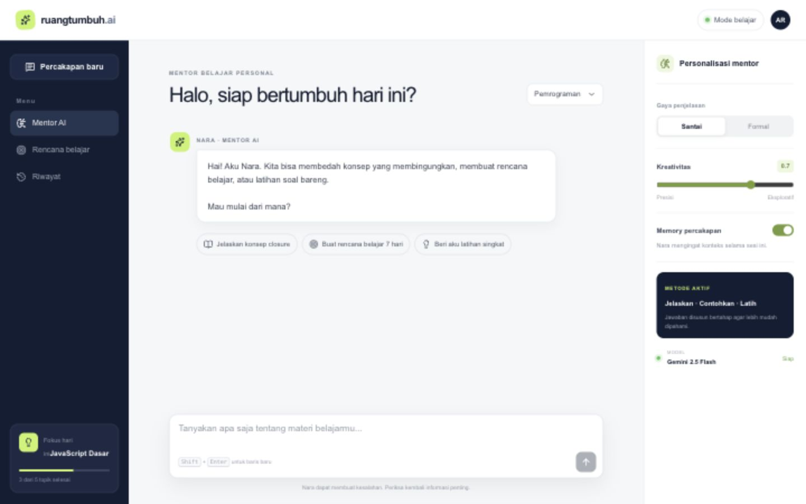
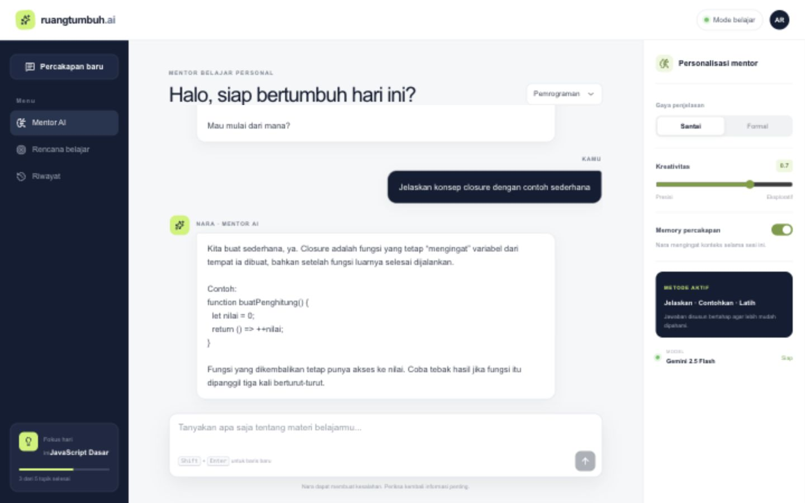

# RuangTumbuh AI

RuangTumbuh AI adalah chatbot mentor belajar personal berbahasa Indonesia. Chatbot menggunakan Gemini 2.5 Flash untuk memahami pertanyaan natural, menjelaskan konsep, memberikan contoh, dan menutup jawaban dengan latihan singkat.



## Fitur

- Percakapan multi-turn dengan Gemini AI
- Persona mentor “Alisha” dengan metode **Jelaskan - Contohkan - Latih**
- Pilihan gaya bahasa santai atau formal
- Temperature yang dapat diatur dari presisi hingga eksploratif
- Memory percakapan berbasis `localStorage`
- Rekomendasi prompt belajar siap pakai
- Mode demo lokal saat API key belum tersedia
- Tampilan responsif untuk desktop dan perangkat mobile
- API key aman di server, tidak pernah dikirim ke browser
- WebMCP tool `start_learning_chat` untuk akses terstruktur oleh agen browser yang mendukung

## Konfigurasi AI

| Parameter | Nilai | Fungsi |
| --- | --- | --- |
| Model | `gemini-2.5-flash` | Respons cepat untuk percakapan edukasi |
| Temperature | `0.0-1.0` | Mengatur variasi dan kreativitas jawaban |
| Top P | `0.9` | Nucleus sampling agar jawaban tetap relevan |
| Top K | `40` | Membatasi kandidat token |
| Max output | `900` token | Menjaga jawaban tetap ringkas |
| System instruction | Persona Alisha | Mengatur bahasa, metode belajar, dan batasan jawaban |

## Arsitektur

```text
Browser (React)
  -> POST /api/chat
  -> Route handler di server
  -> Gemini GenerateContent API
  -> Respons ditampilkan dan disimpan pada memory sesi
```

## Menjalankan proyek

Persyaratan: Node.js 22.13 atau lebih baru dan Gemini API key dari Google AI Studio.

```bash
npm install
cp .env.example .env.local
# Isi GEMINI_API_KEY pada .env.local
npm run dev
```

Buka `http://localhost:3000`.

Tanpa API key, aplikasi otomatis menggunakan mode demo lokal sehingga UI dan alur chat tetap dapat dicoba. Mode demo bukan pengganti model Gemini untuk penggunaan produksi.

## Endpoint

`POST /api/chat`

Contoh request:

```json
{
  "messages": [
    { "role": "user", "text": "Jelaskan konsep closure" }
  ],
  "tone": "santai",
  "temperature": 0.7,
  "subject": "Pemrograman"
}
```

## Screenshot percakapan



## Validasi

```bash
npx oxlint app
npm run build
```

## Keamanan

- Jangan commit file `.env` atau `.env.local`.
- Batasi Gemini API key pada Google Cloud bila aplikasi dipublikasikan.
- Validasi panjang dan bentuk pesan dilakukan di server.

## Teknologi

React 19, TypeScript, Vinext/Vite, Lucide Icons, Cloudflare Workers, dan Gemini REST API.
